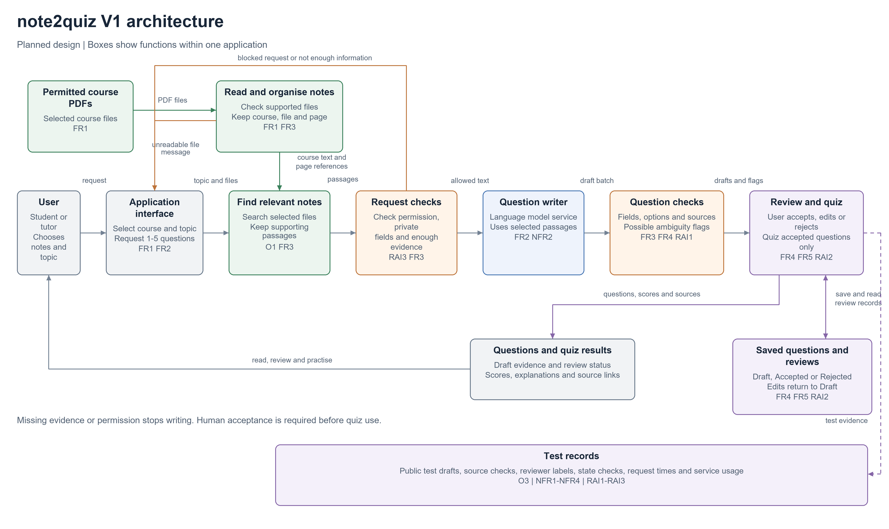

# Architecture decisions for note2quiz

Version: 1.0

## Starting point

User request -> application -> question writer -> draft questions.

The user chooses notes, a topic and a question count. The question writer produces questions and explanations from selected passages. This simple flow can create text, but it cannot by itself keep source pages, check permission, save review decisions or prevent drafts from entering a quiz.

The V1 diagram adds only the functions needed for those requirements. The boxes are functions within the planned application, not a requirement to build a separate service for each box.

## Needs from the requirements

| Requirement | What it needs | Architecture response |
|---|---|---|
| FR1, FR3 / O1 | Read supported notes and retain the selected course, file and page. | Read and organise notes; find relevant notes. |
| FR2, NFR2 | Write questions and explanations from the chosen passages. | Question writer receiving selected passages and the user's topic. |
| FR3, FR4, RAI1 | Detect missing fields, repeated options and questionable source use. | Question checks with access to the draft and original passages; visible flags for review. |
| FR4, FR5, RAI2 | Save decisions and use accepted questions only. | Review and quiz interface; saved questions and reviews. |
| RAI3 | Check permission and sensitive fields before outside processing. | Request checks between finding passages and sending them to the question writer. A failed check returns a message to the interface. |
| NFR1, NFR3, NFR4 / O3 | Measure time, cost and question quality. | Test records containing public test outputs, flags, review labels, timings and usage. |

## V1 diagram

[Editable Draw.io diagram](week2_architecture_v1.drawio)

The question writer is labelled by its function. The provider, model version, search method and software tools will be selected or refined in later labs. User permission and sensitive-field checks apply before selected text is sent outside the application. Question and review records stay in the application.

## Architecture decisions and trade-offs

| Decision | Requirement or constraint | Alternatives considered | Selected option | Trade-off accepted |
|---|---|---|---|---|
| AD1 Keep source pages and find passages before writing | O1 / FR1, FR3 / RAI1 | Use general model knowledge; send every page; find passages from the chosen notes. | Read the notes, keep file and page references, and find relevant passages for the selected topic. | Adds reading and search work. Extraction can lose layout, and search can miss a useful passage, so evidence still needs checking. |
| AD2 Require a saved human review decision | O2 / FR4, FR5 / RAI2 | Use drafts immediately; show warnings only; require explicit acceptance. | Save Draft, Accepted and Rejected states; allow only Accepted questions in quizzes. Editing returns a question to Draft. | Adds review time and storage, but makes the decision visible and keeps unchecked drafts out of quizzes. |

## Initial requirements traceability matrix

Later evidence below is planned, not a claim that tests have passed.

| Objective | Requirement | Evaluation criterion | Architecture element | Later evidence |
|---|---|---|---|---|
| O1 | FR1, FR3 / RAI1 | E2 Source references and support | Read and organise notes; find relevant notes; question checks. | File and page comparisons for 30 draft questions, including checks that only selected files were used. |
| O2 | FR2 / NFR2 | E1 Correctness | Question writer; question checks; review interface. | Independent ratings and final labels for 30 unedited drafts. |
| O2 | FR4, FR5 / RAI2 | E4 Review controls and checks | Question checks; review and quiz interface; saved questions and reviews. | Results for 20 state cases and 20 structural-check cases. |
| O2 | RAI3 | E5 Permission and privacy | Request checks before the question writer. | Outgoing-request inspection for 20 cases using fake personal details. |
| O3 | NFR3 | E3 Clarity | Review interface; test records. | Clarity ratings, initial reviewer agreement and final scores. |
| O3 | NFR1, NFR4 | E6 Time and cost | Question writer; question checks; test records. | Six end-to-end times, recorded service usage and calculated cost. |

## Review of V1

- Every function in the diagram has a requirement in the needs table.
- The diagram includes the course notes, page references, permission check, draft checks and human decision.
- No database brand, model version or extra platform is required at this stage.
- Writing, checking, review and quizzes can be parts of one application. A separate service for every box would add unnecessary work.

## Reflection

AD2 has the most important trade-off. FR4, FR5 and RAI2 require human acceptance before quiz use. This makes question preparation slower, but it avoids treating an unchecked draft as a ready practice question and preserves the reason for a review decision.
