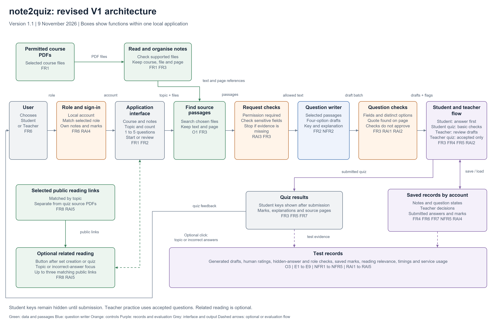

# Architecture decisions for note2quiz

## Starting point

User request → application → question writer → questions and quiz feedback.

The user selects a role, signs in, chooses notes and requests questions. A simple writer can create text, but the app also needs source pages, permission checks, hidden student answers, teacher review, saved marks and optional reading.

The revised V1 diagram shows functions inside one application. A box does not require a separate service or a specific software product.

## Needs from the requirements

| Requirement | What it needs | Architecture response |
|---|---|---|
| FR1, FR3 / O1 | Read supported notes and retain course, file and page. | Read and organise notes; find source passages. |
| FR2 / NFR2 | Write questions, options and explanations using selected passages. | Question writer. |
| FR3, FR4 / RAI1, RAI2 | Check required fields, different options and source-quote matches. | Question checks; visible evidence for teachers and feedback for students. |
| FR4, FR5 / RAI2 | Separate student self-tests from teacher preparation. | Student and teacher flow: students answer before seeing keys; teachers review and use accepted questions. |
| FR6 / RAI4 | Choose a role, sign in and enforce workspace access. | Role and sign-in checks; records separated by account. |
| FR7 / NFR5 | Save quiz answers and marks without later edits rewriting past results. | Saved question, review and quiz records; saved copies of completed quizzes. |
| RAI3 | Obtain permission and check selected text before external processing. | Request checks before the question writer. |
| FR8 / RAI5 | Offer extra reading only when requested. | Optional related-reading function connected to a selected public reading list. |
| O3 / NFR1 to NFR5 / RAI1 to RAI5 | Collect evidence for correctness, controls, reading, records, time and cost. | Test records and the evaluation plan. |

## V1 diagram

## Architecture decisions and trade-offs

| Decision | Requirement or constraint | Alternatives considered | Selected option | Trade-off accepted |
|---|---|---|---|---|
| AD1 Keep source pages and find passages before writing | O1 / FR1, FR3 / RAI1 | General model knowledge; all pages; selected relevant passages. | Retain course, file and page references and find passages from the selected notes. | Extraction may lose layout and matching may miss useful text. A real quote still needs a correctness check. |
| AD2 Use different quiz rules for students and teachers | O2 / FR3 to FR5 / RAI1, RAI2 | Require everyone to review the key; hide all keys; separate the two flows. | Students practise questions passing basic checks, with keys hidden until submission. Teachers inspect and accept drafts; teacher practice uses accepted questions. | Students can encounter factual errors in generated drafts. Show that limit, provide evidence after submission and evaluate question quality. Teacher acceptance remains a separate decision. |
| AD3 Use local accounts and retain quiz records | O2 / FR6, FR7 / NFR5 / RAI4 | One shared workspace; school sign-in; local accounts. | Ask for a role before sign-in, enforce the stored role and keep separate workspaces. Preserve submitted answers and marks. | Accounts are limited to this computer and roles are self-selected. Classroom sharing and school identity checks are outside this version. |
| AD4 Keep related reading optional and start with a selected list | O2 / FR8 / RAI3, RAI5 | No reading feature; live web search; selected public links. | Show up to three matching links only after the user clicks. Use the set topic or incorrect quiz answers. Offer a clear no-match response. | Coverage is limited. A link may not suit the course, so show its publisher and let the user decide. Reading links do not become quiz sources automatically. |

## Requirements traceability matrix

The table below lists the evidence planned for later evaluation.

| Objective | Requirement | Evaluation criterion | Architecture element | Later evidence |
|---|---|---|---|---|
| O1 | FR1, FR3 / RAI1 | E2 Source references and support | Read and organise notes; find source passages; question checks. | File, page and passage comparisons for 30 generated drafts. |
| O2 | FR2 / NFR2 | E1 Correctness | Question writer; teacher review and test records. | Independent correctness ratings and final labels for 30 unedited drafts. |
| O2 | FR3 to FR5 / RAI2 | E4 Quiz rules and checks | Question checks; student and teacher flow. | Results for 20 workflow cases and 20 structural-check cases, including student server responses. |
| O2 | RAI3 | E5 Permission and outgoing data | Request checks before the question writer. | Outgoing-request inspection for 20 cases using fake details. |
| O2 | FR6 / RAI4 | E7 Accounts and roles | Role and sign-in checks; records for each account. | Twelve sign-in, role and other-account access cases. |
| O2 | FR7 / NFR5 | E8 Saved marks | Saved questions, reviews and quiz records. | Six before-and-after record comparisons. |
| O2 | FR8 / RAI5 | E9 Optional reading | Related-reading function; public reading list; application interface. | Relevance ratings, opened links, no-match cases and four optional-button flows. |
| O3 | NFR3 | E3 Clarity | Teacher view and test records. | Independent clarity ratings, agreement and final scores. |
| O3 | NFR1, NFR4 | E6 Time and cost | Question writer; question checks; test records. | Six end-to-end times, usage records and test-date cost calculations. |

## Review of V1

- Source references are retained, but student keys and answer-specific evidence appear only after submission.
- Student eligibility is different from teacher acceptance. Both rules are enforced by the app.
- Optional reading uses a separate public list and does not silently change the quiz sources.
- Accounts, source records, teacher decisions and quiz marks can remain parts of one local application.

## Reflection

AD2 has the main trade-off. Requiring a student to inspect a key before answering would weaken the self-test, while removing teacher review would make preparation harder. Separate flows support both tasks. This also makes correctness testing more important because a source match alone cannot establish that a generated answer is right.

## Week 3 data evidence

The data functions are expanded in the [Week 3 pipeline diagram](week3_pipeline_diagram.png). The [notebook](../notebooks/week3_pipeline.ipynb) and [pipeline decisions](week3_pipeline_decisions.md) link FR1, FR3 and RAI1 to 62 prepared passages with source files and PDF pages. The local and Google Colab preparation checks passed. They support E2 but do not replace the planned question-quality evaluation.
